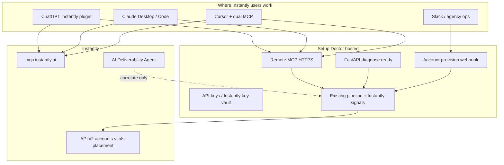

# Setup Doctor × Instantly — Industry-Ready End-to-End Plan

> Status: **Phase 0 implemented in-repo** (hosted MCP + Instantly header + Docker + connect docs + `/pre-launch-gate`). Next: Phase 1 (`launch_verdict`, fix packets, webhook).  
> Owner surface rule: Findings = deterministic DNS only; Instantly = signals / `unknown` / `not_checked`.  
> Schema: keep `DiagnosisResult.schema_version` **1.0**; additive fields only (null defaults).

---

## Goal

Make Setup Doctor the **deep DNS pre-launch doctor** Instantly GTM users reach from the same AI surfaces they already use (ChatGPT Instantly plugin, `mcp.instantly.ai`, Cursor/Claude) — without competing with Instantly’s placement, warmup, or Deliverability Agent pause actions.

**One-sentence product:** Instantly says whether mailboxes/placement look OK; Setup Doctor says exactly which DNS Findings block a safe launch — in the same agent chat — never inventing health when data is missing.

---

## Codebase baseline (verified Nov 2026)

| Capability | Status | Where it lives |
|---|---|---|
| Deterministic SPF/DKIM/DMARC/MX Findings + verified LLM rewrite | Done | `checks/`, `explain/`, `pipeline/` |
| Instantly read-only client (injectable key + transport) | Done | `integrations/instantly/client.py` (`api_key=` already supported) |
| Warmup vs placement compare + domain filter | Done | `integrations/instantly/compare.py` |
| Workspace readiness + vitals/CTD/agent signals | Done | `integrations/instantly/readiness.py` |
| Instantly rewrite grounding + mutant | Done | explain Instantly path + `evals/mutations/` |
| CLI Instantly flags | Done | `surfaces/cli.py` (`--with-instantly`, `--instantly-compare`, `--instantly-ready`, `--from-instantly`) |
| HTTP API + `ApiKeyAuth` + rate limit + hostname SSRF guard | Done | `surfaces/api.py`, `surfaces/auth.py` |
| MCP tools (`diagnose`, `compare_instantly`, `instantly_ready`) | Done — **stdio only** | `surfaces/mcp_server.py` (`TOOLS` handlers already shared) |
| Cursor skills `/instantly`, `/diagnose`, … | Done — **local CLI/MCP** | `.cursor/skills/` |
| Hosted / remote MCP (HTTP or SSE) | **Missing** | — |
| Per-request / per-tenant Instantly key on surfaces | **Missing** | API/MCP always `InstantlyClient()` → env |
| Docker / compose deploy | **Missing** | — |
| `docs/INSTANTLY_CONNECT.md` dual-MCP pack | **Missing** | — |
| `/pre-launch-gate` skill | **Missing** | — |
| `launch_verdict` / `pre_launch_gate` tool | **Missing** | — |
| Registrar fix packets / webhooks / web UI | **Missing** (P1–P3) | — |

**Adoption bottleneck:** CLI + local stdio MCP. Instantly users live in hosted MCP / ChatGPT. They will not paste env keys into a terminal if Instantly is already one click away.

### What we reuse (do not reinvent)

```
surfaces/mcp_server.py::TOOLS[*].handler   → shared tool core for stdio + HTTP
surfaces/auth.py::ApiKeyAuth               → MCP HTTP + API (already Bearer / X-API-Key)
surfaces/api.py::instantly_factory         → extend to resolve Instantly key per request/tenant
integrations/instantly/client.py           → InstantlyClient(api_key=…) already exists
integrations/instantly/readiness.py        → launch_verdict computed ON TOP of report (P1)
pipeline.diagnose_result                   → only engine; no DNS in skills/Markdown
```

Dependency direction unchanged: `surfaces → pipeline → checks/explain → dns/core`; Instantly stays signals-only.

---

## Non-goals (explicit)

- Seed inbox placement / warmup networks (Instantly, GlockApps, MailReach)
- Prospect email verification / SuperSearch / AI SDR
- Write Instantly mutations (pause accounts, enable warmup, activate campaigns) — leave to Instantly Deliverability Agent + Instantly MCP
- Fabricating 0–100 “healthy” when Instantly or DNS data is missing
- Parallel DNS logic in skills, ChatGPT Actions, or web UI

---

## Architecture target



### Surface matrix (target)

| Surface | Auth | Instantly key | Tools / routes |
|---|---|---|---|
| CLI (OSS) | n/a | `INSTANTLY_API_KEY` env | existing flags |
| HTTP API | `SETUP_DOCTOR_API_KEYS` | env **or** `X-Instantly-Api-Key` **or** tenant vault | `/diagnose`, `/instantly/*`, `/connect/instantly` (P0.2), `/hooks/instantly` (P1) |
| MCP stdio | none (local trust) | env | existing 3 tools |
| MCP remote HTTP | same as API | same as API | same 3 tools + `pre_launch_gate` (P2) |
| Skills | call MCP/CLI only | never embed keys | dual-MCP `/pre-launch-gate` |

---

## Locked decisions

| Decision | Choice |
|---|---|
| Instantly write APIs | **Never** in this repo |
| Primary distribution | Hosted MCP + dual-MCP beside Instantly (not a ChatGPT competitor) |
| Primary GTM workflow | Pre-launch gate before campaign activate |
| Schema bumps | Additive only on 1.0; no re-rank / invent Findings |
| Instantly key P0 | **Per-request header first** (`X-Instantly-Api-Key`); env fallback; optional vault next |
| MCP transport P0 | Streamable HTTP preferred; SSE acceptable if SDK forces it; keep stdio |
| Launch scoring | Deterministic function over Findings + Instantly verdicts only |
| Start | **Phase 0** |

### Instantly key resolution order (all hosted surfaces)

1. Explicit constructor / test factory  
2. Request header `X-Instantly-Api-Key` (never logged)  
3. Tenant vault lookup keyed by `Tenant.tenant_id` (P0.2b / hosted)  
4. Process env `INSTANTLY_API_KEY`  
5. Else → clear `config` error (`400` / MCP `{"error":"config"}`) — **never** fake Instantly signals

---

## Phase 0 — Distribution unlock (highest leverage)

**Outcome:** An Instantly agency can add Setup Doctor beside Instantly MCP in under 5 minutes.

### 0.1 Hosted / remote MCP

**Work:**

1. Extract nothing new if avoidable — keep `TOOLS` handlers as the single tool core.
2. Add HTTP MCP entry alongside stdio in `surfaces/mcp_server.py` (or thin `surfaces/mcp_http.py` that imports `TOOLS`).
3. Prefer MCP Python SDK streamable HTTP / SSE via FastMCP (`transport=` beyond `"stdio"`).
4. Mount auth: reuse `ApiKeyAuth` on MCP HTTP (401 if keys configured and missing/invalid).
5. Same tools: `diagnose`, `compare_instantly`, `instantly_ready`.
6. Deploy: single process preferred — FastAPI app + MCP HTTP route/sidecar via Docker Compose.

**Files (expected):**

- `src/setup_doctor/surfaces/mcp_server.py` (or split `mcp_http.py`)
- `src/setup_doctor/surfaces/api.py` (optional mount / health sharing)
- `Dockerfile`, `docker-compose.yml`
- `pyproject.toml` extras if MCP HTTP needs pinned deps
- `tests/surfaces/test_mcp_http.py` (auth reject, tool call shape, no secret leakage)

### 0.2 Instantly key attachment

**P0.2a (ship first):** plumb `X-Instantly-Api-Key` through API + MCP HTTP into `InstantlyClient(api_key=…)`.

- Add helper e.g. `surfaces/instantly_ctx.py::resolve_instantly_client(...)`.
- Wire API endpoints that call Instantly + MCP Instantly tools.
- MCP stdio continues env-only (local).

**P0.2b (hosted follow-up):** `POST /connect/instantly` stores encrypted key per tenant.

- Encrypt at rest (env master key); OSS self-host may skip and use env only.
- Never print keys; logs use `Tenant.api_key_id` fingerprint pattern only.

### 0.3 Connector pack

Ship drop-in snippets — **no DNS logic in Markdown**:

- `docs/INSTANTLY_CONNECT.md` — one-pager dual MCP
- Example Cursor `.cursor/mcp.json` dual entry (Instantly + Setup Doctor URL)
- Claude Desktop connectors JSON snippet
- ChatGPT Custom GPT Actions: OpenAPI pointing at hosted `/diagnose`, `/instantly/ready` (same engine)

### 0.4 Dual-MCP Cursor skill `/pre-launch-gate`

New `.cursor/skills/pre-launch-gate/SKILL.md` that **only** shells/MCP-calls:

1. Instantly MCP: list accounts / vitals (or our `instantly_ready` if Instantly MCP unavailable)
2. Setup Doctor: `instantly_ready` or per-domain `diagnose` with `include_instantly`
3. Present: Findings first, Instantly mismatches second, unknowns honest
4. Instruct agent: **do not** call Instantly `activate_campaign` while critical/high Findings remain

Update `.cursor/skills/instantly/SKILL.md` to point at the gate skill (still no DNS logic).

### Phase 0 exit criteria

- [x] Documented dual-MCP connect works in Cursor (doc + example config)
- [x] Remote MCP auth gate + streamable HTTP mount (`/mcp`); tools still return schema 1.0
- [x] Missing Instantly key → `config` error, not fabricated signals
- [x] `pytest` (153), Instantly fixtures, `evals/run_evals.py`, `evals/mutation_check.py` green
- [x] No secrets in logs (assert in tests)

### Phase 0 sprint tickets (ordered)

| # | Ticket | Done when |
|---|---|---|
| P0-T1 | Shared Instantly client resolver (header → env) | API Instantly routes accept `X-Instantly-Api-Key`; unit tests |
| P0-T2 | MCP HTTP transport + auth middleware | Authenticated remote tool call works; 401 without key when configured |
| P0-T3 | MCP Instantly tools use resolver | Header/env path covered; stdio unchanged |
| P0-T4 | Dockerfile + compose (API + MCP HTTP) | `docker compose up` serves `/healthz` + MCP |
| P0-T5 | `docs/INSTANTLY_CONNECT.md` + example mcp.json | Agency can copy-paste |
| P0-T6 | Skill `/pre-launch-gate` | Thin MCP/CLI only; no SPF/DKIM prose invented |
| P0-T7 | Tests: auth reject, injected Instantly factory, no key in logs | CI green |

---

## Phase 1 — Instantly-user product UX

**Outcome:** GTM engineer gets a launch decision and paste-ready DNS fixes without reading DNS RFCs.  
**Depends on:** P0 tenant/request Instantly key path.

### 1.1 Deterministic launch score

Compute in `integrations/instantly/` (not LLM):

| Verdict | Rule |
|---|---|
| `blocked` | Any Finding with severity `critical` |
| `caution` | Any `high`/`medium` Finding **or** Instantly compare `mismatch` **or** vitals `disagree` |
| `ready` | No auth Findings that block + no Instantly mismatch/disagree + Instantly **was checked** |
| `unknown` | Instantly not checked / Instantly error / indeterminate vitals without DNS blockers |

**Never** map missing Instantly data → `ready`.

Attach on `WorkspaceReadinessReport` (and optionally domain row) as additive fields:

```json
{
  "launch_verdict": "blocked",
  "launch_score": null,
  "blocking_finding_ids": ["SPF_MISSING"],
  "instantly_mismatches": [],
  "not_checked": ["reputation"]
}
```

`launch_score` optional numeric later; verdict is the product contract. Prefer null score until calibrated — do not invent 0–100 health.

### 1.2 Paste-ready DNS fix packets

- Module: `explain/fix_packets/` or `integrations/dns_packets/`
- Findings → registrar templates (Cloudflare, Namecheap, GoDaddy, Google Domains-style)
- Templates only; LLM may reorder/explain but verifier rejects invented record strings not grounded in Findings
- CLI: `--fix-packet cloudflare`; API: `fix_packet_provider`
- Fixture: Cloudflare packet for a labeled mess domain

### 1.3 Better Instantly ESP awareness

- When Instantly accounts present, default `--esp-pack instantly` (already partially done in MCP/API)
- If account metadata exposes provider (Google/Microsoft/AirMail), merge matching ESP selector packs
- Prefer selectors from Instantly when API exposes them; else keep guess packs + explicit `evidence.limitation`

### 1.4 Provisioning webhook

- `POST /hooks/instantly` (HMAC signed secret)
- Payload: account create / DFY ready / domain list
- Enqueue diagnose for sender domain(s); store last result; optional Slack notify
- Idempotent + rate-limited; Instantly failure ⇒ `unknown` / error, no invented Findings

### 1.5 Agency multi-workspace

- Instantly workspace-group admin key: iterate sub-workspaces → readiness summary
- CLI: `--instantly-ready --all-workspaces` (document required scopes)
- Only if Instantly API exposes workspace listing with current scopes — otherwise document limitation, do not fake

### Phase 1 exit criteria

- [ ] Readiness JSON includes `launch_verdict`
- [ ] Cloudflare packet fixture + unit test
- [ ] Webhook unit tests with signed fixtures
- [ ] README Instantly agency flow updated (honest numbers)

---

## Phase 2 — Agent workflows

**Outcome:** Agents reliably gate Instantly launches without hallucinating DNS.  
**Depends on:** P1 `launch_verdict`.

### 2.1 `pre_launch_gate` MCP tool

First-class tool wrapping readiness (+ optional domain filter):

```json
{
  "allowed_to_activate": false,
  "launch_verdict": "blocked",
  "blocking_finding_ids": ["SPF_MISSING"],
  "instantly_mismatches": [],
  "not_checked": [],
  "markdown": "..."
}
```

Rule: `allowed_to_activate == true` **iff** `launch_verdict == ready`.

### 2.2 Verified registrar playbooks

- Versioned in-repo snippets (no live scrape)
- Optional LLM rewrite grounded against packet + Findings; fallback = template packet

### 2.3 Speakable summaries

- `summary_spoken` (2–4 sentences) from Findings + Instantly notes
- Same Instantly rewrite verifier / grounding rules

### 2.4 Compose with Instantly Deliverability Agent (read-only)

- Already partially: agent state/feed in readiness
- Skill text: quote Instantly pause recommendations; Setup Doctor explains DNS depth; **do not** auto-pause via Setup Doctor

### 2.5 Eval / honesty expansion

- Guardrail: inventing `allowed_to_activate: true` with critical Finding → reject
- Mutant: gate ignores critical Findings → killed
- Keep Instantly rewrite mutant
- Update `evals/RESULTS.md` honestly (no inflated shadow P/R)

### Phase 2 exit criteria

- [ ] `pre_launch_gate` MCP tool + evals/mutants green
- [ ] Spoken summary grounded
- [ ] Still zero Instantly write endpoints

---

## Phase 3 — Productization & market parity

**Outcome:** Industry-ready packaging agencies can sell/use beside Instantly.  
**Depends on:** P0 hosted deploy (P1/P2 deepen value).

### 3.1 Public web checker

- Minimal hosted UI → same `diagnose_result`; optional Instantly connect
- Rate limits + captcha/API key; no parallel DNS logic

### 3.2 Agency reports

- White-label markdown export from readiness (PDF optional extra)
- Per-client workspace snapshot for handoff

### 3.3 Marketplace / partner positioning

- Instantly Partner / Experts listing: “DNS Doctor for Instantly workspaces”
- OpenAPI + MCP directory listings

### 3.4 Optional advisory packs (opt-in only)

- Domain age / WHOIS as advisory signal (`unknown` on failure)
- Optional copy spam-phrase pack — never DNS Findings

### Phase 3 exit criteria

- [ ] Deployable web check
- [ ] Agency export
- [ ] Marketing that Instantly owns placement; Setup Doctor owns DNS Findings

---

## Sequencing


| Phase | Rough effort | Depends on |
|---|---|---|
| P0 | 2–3 weeks | Existing MCP `TOOLS` + `ApiKeyAuth` + Instantly client |
| P1 | 2–4 weeks | P0 Instantly key path |
| P2 | 3–5 weeks | P1 `launch_verdict` |
| P3 | ongoing | P0 hosted deploy |

Every phase ships with: `pytest`, Instantly recorded fixtures, `evals/run_evals.py`, `evals/mutation_check.py`, honest README / `evals/RESULTS.md`.

---

## Test & honesty matrix

| Concern | Coverage |
|---|---|
| Auth reject on MCP HTTP | `tests/surfaces/test_mcp_http.py` |
| Instantly header overrides env | API + MCP unit tests with injected transport |
| Secrets never logged | Assert fingerprints only; key substring absent from caplog |
| Missing Instantly → unknown/config | Existing Instantly fixtures + new gate cases |
| Critical Finding ⇒ not allowed | P2 guardrail + mutant |
| No write Instantly paths | Grep/CI contract: client methods stay GET/read POSTs already documented only |
| Schema 1.0 additive | `evals/contracts/` |

---

## Success metrics (honest)

| Metric | Target |
|---|---|
| Time for Instantly agency to connect Setup Doctor in Cursor | < 5 minutes |
| Dual-MCP pre-launch gate without inventing Findings | Eval + mutant green |
| Instantly missing data reported as unknown / config | 100% of fixtures |
| Critical Finding ⇒ `allowed_to_activate=false` | 100% |
| No Instantly write endpoints in this repo | Continues |

---

## Risks & mitigations

| Risk | Mitigation |
|---|---|
| Competing with Instantly Deliverability Agent | Correlate only; no pause APIs |
| Hosted MCP abuse / SSRF | Existing hostname validation; rate limits; API keys |
| LLM invents DNS for Instantly users | `verify_plan` + Instantly rewrite + gate evals |
| Scope creep into placement SaaS | Non-goals list; PR review against Instantly categories |
| Vault complexity blocks P0 | Ship header+env first; vault is P0.2b |

---

## Open questions (resolve during P0 kickoff)

1. **Host target:** single Fly/Railway/Render service vs Cloudflare Workers (Python MCP may prefer container)?  
2. **MCP URL public shape:** `https://mcp.setup-doctor…/mcp` vs path on same API host?  
3. **ChatGPT path priority:** Custom GPT Actions on FastAPI first, or wait for ChatGPT remote MCP support?  
4. **Tenant vault crypto:** required for first hosted beta, or header-only beta OK?

Default recommendation if unblocked: **container on same host as FastAPI**, MCP at `/mcp`, ChatGPT Actions on FastAPI first, **header-only Instantly key for first hosted beta**.

---

## Implementation start checklist

When execution begins, do in order:

1. P0-T1 Instantly key resolver + API header tests  
2. P0-T2 MCP HTTP + auth  
3. P0-T3 wire Instantly tools  
4. P0-T4 Docker  
5. P0-T5 connect docs  
6. P0-T6 `/pre-launch-gate` skill  
7. P0-T7 full CI gate  

Do **not** start P1 launch_verdict or web UI until P0 exit criteria pass.
